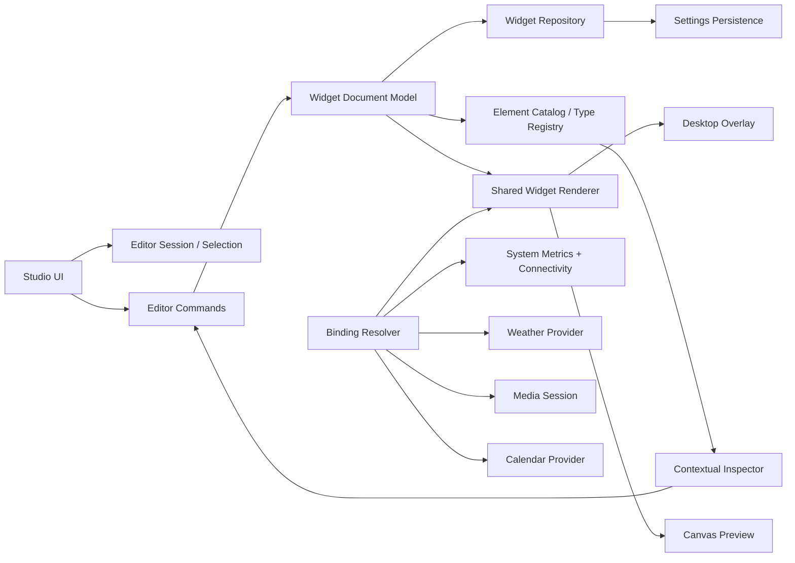

# Custom Widget Studio

## 1. Purpose and scope

Custom Widget Studio is a visual editor for composing, styling, and publishing desktop widgets from reusable elements. It combines a drag-and-drop canvas with type-aware property panels and live data bindings. The same saved widget must render consistently in the editor preview, dashboard card, and desktop overlay.

This specification defines the target experience and architecture for the current Flutter/Windows application. It distinguishes existing foundations from capabilities that still need implementation; requirements in this document are not claims that every listed control already exists.

### Product goals

1. Make every visible part of a widget individually discoverable and editable.
2. Keep the canvas easy to use for first-time users while exposing detailed controls on demand.
3. Configure data at the element or widget level without embedding device-specific readings in a design.
4. Preserve user work across editor sessions, app restarts, and schema evolution.
5. Clearly communicate unavailable permissions, data sources, and device capabilities without substituting fabricated readings.

### Out of scope

- Arbitrary executable scripts or user-authored code inside widgets.
- Cloud synchronization of widget designs unless separately approved and designed.
- Promising GPS access on Windows devices that do not provide a location provider.
- Destructive device, network, or OS configuration from a display widget.

## 2. Current application baseline

The application already has a Flutter-based Studio, a `CustomWidgetElement` layout model, a shared `CustomWidgetRenderer`, a saved-widget collection, a drag-and-drop element library, an element inspector, and Windows services for system metrics, connectivity, media sessions, and weather. Custom layouts are stored through `WidgetSettings` and `SavedCustomWidget`.

The current model includes position, dimensions, text, font, color, active/disabled colors, font size, letter spacing, bold, opacity, rotation, and gradient color values. System and weather starter presets and their live readings are also present. The editor supports basic text/font/color/size editing and some geometric controls.

The target design extends these foundations. In particular, reliable model parsing and data-binding contracts, a true empty-canvas creation path, rich text and graphic effects, per-widget functional settings, full 3D/layer transforms, and configurable weather units/forecast behavior should be treated as planned work rather than assumed behavior.

## 3. Experience principles

- **Selection reveals intent:** selecting an element selects it on the canvas, highlights its layer, and opens its matching inspector.
- **Progressive disclosure:** common controls appear first; advanced styling, transforms, bindings, and animation are grouped into expandable sections.
- **Live but honest:** preview values are explicitly live, sample, cached, or unavailable. Sample data is never presented as a real reading.
- **Safe by default:** location and device data use least privilege; external data connections disclose their source and status.
- **One source of truth:** an element's serialized model drives the layer list, inspector, preview, and overlay renderer.
- **Reversible editing:** undo/redo, duplicate, delete, and reset controls protect against accidental changes.
- **Responsive precision:** direct manipulation is supplemented by numeric fields and keyboard-accessible controls.

## 4. Information architecture

### Studio shell

The Studio uses four coordinated areas:

1. **Top command bar** — Back, widget name, save status, undo/redo, preview/run, and overflow actions.
2. **Layers panel** — ordered tree of parsed elements and groups; search, visibility, lock, rename, duplicate, delete, and reorder.
3. **Canvas** — transparent/grid background options, zoom, pan, snap guides, selection handles, contextual drop targets, and live preview.
4. **Inspector/library panel** — an inspector for the current selection, or the element library when nothing is selected. Tabs provide Layers, Elements, and Widget Settings without replacing the canvas.

At narrow window widths, the layers and inspector panels may collapse into drawers. The canvas remains the primary surface, and selection state must survive panel changes.

### Widget settings

Widget-level settings are separate from element styling:

- **General:** name, size, target display, anchor/position, click-through and editor interaction mode.
- **Data:** data sources currently used, refresh interval, status, last update, and source-specific options.
- **Appearance:** canvas background, surface treatment, overall scale, and optional widget-level animation.
- **Behavior:** startup/visibility behavior and permitted interactions.

Only relevant setting groups are shown for a widget's detected capabilities.

## 5. Functional architecture



### Logical components

| Component | Responsibility |
|---|---|
| `CustomWidgetBuilderView` / Studio shell | Own editor session, selection, panel layout, focus, and unsaved state. Delegate editing to typed commands rather than directly mutating unrelated state. |
| Widget document model | Own stable widget identity, dimensions, elements, widget settings, bindings, and schema version. Serialize/deserialize with validation. |
| Element type registry | Describe supported element types, default values, inspector sections, accepted bindings, renderer, capability requirements, and library metadata. |
| Document parser/validator | Normalize saved documents, migrate older schemas, resolve unknown element types, validate bindings, and produce diagnostics for the editor. |
| Command/history manager | Apply atomic edits, record undo/redo history, batch drag gestures, and mark the document dirty. |
| Element library | Filter and instantiate text, graphic, data, and composed UI-block elements. Drag/drop uses factories with stable type IDs and initial geometry. |
| Contextual inspector | Render type-specific controls based on registry metadata and selection, with shared style/transform sections. |
| Binding resolver | Subscribe to required data sources, normalize source values, expose loading/permission/error states, and update previews without changing the saved design. |
| Shared renderer | Render a document identically in preview and desktop overlay using supplied data snapshots and interaction policy. |
| Widget repository | Save, load, duplicate, rename, delete, import/export, and migrate saved documents. |

### Component parsing and contextual identification

Selection must not rely on reverse-engineering arbitrary rendered pixels. A widget is a structured document, and each element is identified by its stable `id` and registered `type`. When a saved document is opened:

1. Deserialize the document and migrate its schema version.
2. Validate every element against the type registry.
3. Resolve bindings and report unknown types, invalid properties, or unavailable capabilities.
4. Populate the layer tree from the normalized element graph.
5. On selection, locate the model element by ID and build its inspector from its type definition.

For imported or legacy widgets, the parser may infer a type from known legacy IDs and properties. Inference must be deterministic and reversible; ambiguous elements remain editable as generic elements and are marked for review. The editor must never silently discard unknown serialized fields.

### Data flow and refresh

- The editor requests only sources needed by the current document.
- Multiple elements using the same source share one subscription/request.
- Each source publishes typed snapshots with `loading`, `ready`, `stale`, `unavailable`, `permissionDenied`, or `error` state, a timestamp, and an optional diagnostic.
- Refresh cadence is configured per source/widget and bounded by safe minimum and maximum intervals.
- Preview rendering reads snapshots; it does not initiate a network or OS call from a paint/build method.
- Closing the editor or overlay releases subscriptions and timers.
- A failed refresh retains a clearly marked last-known value only if a cached value exists; otherwise show a type-appropriate unavailable state.

## 6. Element and document state model

### Widget document

The document is the saveable design. Runtime metrics and transient UI state must not be persisted as design values.

| Field | Type | Meaning |
|---|---|---|
| `schemaVersion` | integer | Migration version for the serialized document. |
| `id`, `name` | string | Stable identity and user-facing name. |
| `width`, `height` | number | Logical canvas size. |
| `elements` | ordered list | Element/group nodes; order defines z-order unless overridden. |
| `settings` | object | Widget-level display, behavior, data refresh, and source configuration. |
| `createdAt`, `updatedAt` | timestamp | Creation and last-save time. |

### Element model

Keep stable identity and type separate from editable properties. Use typed property groups rather than adding unrelated top-level fields for each new feature.

```json
{
  "id": "stable-element-id",
  "type": "text",
  "name": "City",
  "visible": true,
  "locked": false,
  "transform": {
    "x": 20,
    "y": 20,
    "width": 220,
    "height": 32,
    "rotationX": 0,
    "rotationY": 0,
    "rotationZ": 0,
    "scaleX": 1,
    "scaleY": 1,
    "depth": 0
  },
  "style": {
    "opacity": 1,
    "fill": { "kind": "solid", "color": "#FFFFFFFF" },
    "stroke": { "enabled": false, "color": "#FF000000", "width": 0 },
    "cornerRadius": 0,
    "shadow": null
  },
  "content": {
    "text": "Seattle",
    "fontFamily": "Segoe UI",
    "fontSize": 16,
    "weight": 400,
    "letterSpacing": 0,
    "alignment": "start"
  },
  "binding": null,
  "animation": null
}
```

The above is a target shape, not a required one-step rewrite of the current serialized format. Maintain backwards compatibility through explicit migrations from the current `x`, `y`, `width`, `height`, `fontFamily`, `color`, `fontSize`, `opacity`, `rotation`, and related fields.

### Type-specific state

- **Text:** editable content or binding, typography, alignment, wrapping, fill, gradient, outline, inline stroke, shadow, perspective, and animation.
- **Icon/vector:** icon or asset reference, tint, fill/stroke, size, opacity, border, rotation, and optional state-dependent appearance.
- **Image/photo:** asset URI, crop rectangle, fit, mask shape, tint/filter, opacity, border, and loading/error state.
- **Data display:** binding identifier, value format, units, thresholds, visual mode, stale policy, and data-source capability.
- **Container/UI block:** child element IDs, padding, layout direction, gap, alignment, fill, border, and radius.
- **Group:** ordered child IDs, group transform, and clipping policy. Grouped child coordinates must be defined consistently in local coordinates.

### Editor-only state

Do not persist the following as document content unless separately indicated:

`selectedElementId`, selected layer, active inspector section, open panel, zoom, pan offset, snap overlay, active tool, focused input, drag state, hover state, preview clock, transient source status, and undo/redo history.

The dirty state is derived from the last saved document revision versus the current revision. Autosave, if enabled, must use an explicit draft/recovery path distinct from the committed saved widget.

### Element lifecycle

```text
Library item
  -> instantiate with defaults
  -> drag/drop or keyboard insert
  -> placed element (selected)
  -> edit properties / binding
  -> saved document
  -> parsed and rendered in preview / overlay
  -> duplicate, group, reorder, hide, lock, or delete
```

### Data-binding model

A binding should be a typed reference, not a cached display string:

```json
{
  "source": "weather.current.temperature",
  "parameters": { "unit": "celsius" },
  "format": { "kind": "number", "decimals": 1, "suffix": "°C" },
  "fallback": { "kind": "unavailable", "text": "—" }
}
```

The binding resolver owns the live value and source state. The element owns presentation, formatting overrides, and optional thresholds. This separation allows one design to move between devices without embedding a stale CPU value or location reading.

## 7. Contextual inspector specification

On selection, the inspector header shows element type, name, visibility/lock state, and a type icon. Available panels are composed from:

1. **Content / Data** — edit text or choose a binding, format, unit, and fallback.
2. **Style** — fill, color, gradient, stroke, shadow, opacity, and type-specific appearance.
3. **Transform** — position, size, 2D/3D rotation, scale, tilt, and depth/layer order.
4. **Animation** — preset, duration, easing, direction, trigger, and keyframes.
5. **Accessibility** — semantic label, contrast warning, and reduced-motion behavior where applicable.

Unsupported options are omitted, not displayed disabled without explanation. A shared section may appear on every element where the operation is meaningful.

### Text controls

- Font family from local/approved app fonts; report unavailable fonts.
- Font size, weight, line height, letter spacing, alignment, wrapping, and truncation.
- Solid fill or linear/radial multi-stop gradient with editable stops, positions, and angle/center.
- Outline/stroke color, width, joins, and inline stroke settings.
- Shadow color, blur, offset, and spread.
- Perspective and 3D transform controls with numeric entry and reset.
- Typewriter, pulse, marquee, and wave animation presets with live preview.
- Bindable content with an optional prefix/suffix and explicit unavailable placeholder.

### Icon, vector, and photo controls

- Switch vector icon or replace image asset; show source and asset availability.
- Crop/fit and mask selection (circle, rounded rectangle, and supported custom shapes).
- Opacity, tint, supported filters, stroke/border color and width, and corner radius.
- For image replacement, preserve geometry and offer an explicit crop reset.
- Unsupported filters must not corrupt or destructively rewrite the source asset.

### Geometry, depth, and layers

- Canvas drag updates position; shift/keyboard arrows provide fine nudging.
- Inspector accepts exact numeric x/y/width/height values.
- Rotation X/Y/Z, scale X/Y, tilt, and depth/layer reorder are editable in the inspector.
- Dragging a layer changes z-order; display a clear insertion indicator.
- Clamp or warn on invalid dimensions and out-of-canvas placement. Do not silently change a user's entered value without visible feedback.
- Group operations and alignment/distribution actions apply to a multi-selection.

## 8. Canvas and element library

### Empty-canvas creation

“Launch New Custom” opens a new document with no elements, a visible grid, default canvas dimensions, and an empty-state prompt: “Drag an element here or choose one from the library.” It must not load the legacy default clock composition. Creating a new widget and editing an existing saved widget are separate commands.

The empty canvas offers:

- Add Text, Add Icon, Add Image, Add Container, and Add Data Widget quick actions.
- Undo/redo, zoom-to-fit, zoom controls, and canvas-size presets.
- A drag target that reports accepted/rejected drops and creates a uniquely identified element.

### Element library

Categories are searchable and filterable:

- **Basics:** text, rich text, icon, image, shape, container, group.
- **Time and date:** clock parts, full time/date, calendar.
- **System:** CPU, RAM, disk/partition, battery, network/connectivity.
- **Weather:** temperature, condition, location, feels-like, humidity, forecast row.
- **Media:** artwork, title, artist, progress, elapsed/duration, transport controls.
- **Blocks:** weather capsule, system summary, media card, calendar block.

Library items are factories that produce new element models with meaningful defaults and valid initial geometry. A “block” may create multiple child elements inside a group; users can ungroup and edit each child.

## 9. Function-aware widget settings and bindings

### Capability detection

The type registry contributes required capabilities from the document's elements. The widget settings panel is composed from the union of those capabilities. An explicit user configuration may override defaults, but an element may not silently request capabilities that its type does not support.

| Capability | Sources and settings |
|---|---|
| System performance | CPU/RAM snapshot, refresh interval, unit/format, thresholds, display as text/bar/gauge. Do not expose process-specific telemetry unless separately authorized. |
| Storage | Enumerate supported volumes/partitions, label/path target, used/free/total values, refresh interval, byte unit and decimal precision, bar/circular/text presentation. Default to the system volume, but provide an explicit picker and an unavailable state if a volume is inaccessible. |
| Battery | Charge percentage, charging state, time remaining when available, refresh interval, indicator style, low/high thresholds. Non-battery desktop devices show unavailable rather than an invented percentage. |
| Weather | Auto-detected location or manual search; source and location status; Celsius/Fahrenheit; current conditions and forecast range; refresh interval; icon set; animation overlay and reduced-motion behavior. |
| Media | Active session selection policy, artwork visibility, transport controls, metadata fields, and progress display. Transport buttons appear only when the source reports the capability. |
| Calendar | System/app calendar provider, selected calendars, event range, refresh interval, and permission status. Calendar sync is opt-in and must show the provider and access state. |
| Connectivity | Wi-Fi/Bluetooth status and, only where supported and permitted, toggles. Clearly distinguish read-only state from an actionable control. |

### Weather location and units

Prefer an OS-provided location capability where the platform actually supports it and the user grants permission. On Windows, IP-based geolocation is an approximate fallback, not GPS: label it as approximate, provide a manual location search, and let the user disable automatic location. Do not imply GPS precision where the source does not provide it.

Store normalized weather measurements and unit preference separately. Convert for display; changing °C/°F must not trigger location replacement or mutate the saved widget design. Display “last updated” and stale/error state when the provider is unavailable.

### Storage settings

Storage configuration targets a specific volume/partition identifier, not a brittle display label alone. The resolver reports total, used, and available bytes with the volume identity. The presentation mode (circular gauge, linear progress, or text) is a display preference on the element; volume target and refresh interval are source/widget settings.

### Permission, privacy, and failure behavior

- Ask for permission only when the user enables a feature requiring it.
- Explain the data used and whether it leaves the device before confirmation.
- Offer manual or read-only alternatives whenever feasible.
- Never show sample values as live values.
- Provide `Unavailable`, `Permission required`, and `Retry` states appropriate to source capability.
- Do not log precise location, media metadata, or personal calendar events.

## 10. Step-by-step UI workflows

### A. Create a widget from scratch

1. Open **Widgets → Custom Widgets → Launch New Custom**.
2. Create an empty, named draft with grid visible; show the element library and empty-state guidance.
3. Search or browse the library; drag an item onto the canvas or activate “Add.”
4. Place and snap the element; select it automatically and open its contextual inspector.
5. Edit content/style/transform; preview updates immediately using live values or explicitly marked placeholders.
6. Add additional elements, group/reorder them, and configure bindings as needed.
7. Open **Widget Settings** to configure required data sources, refresh intervals, and permissions.
8. Save; validate the document, report validation errors inline, and persist the versioned document.
9. Choose **Preview on Desktop** or **Apply**; the desktop overlay renders the same saved document and binding configuration.

### B. Edit an existing widget

1. Select the saved widget card or choose **Edit** from its action menu.
2. Load a copy of the saved document into an editor session; retain the saved version until save succeeds.
3. Parse and validate elements, populate the layer tree, and report unknown/migrated elements.
4. Select an element in the layer tree or on the canvas; synchronize selection and open the correct inspector.
5. Make changes; batch continuous gestures into one undo action and update dirty state.
6. Save to update the existing widget, or **Save As** to create a copy. Cancel/back prompts only when unsaved changes exist.

### C. Customize a text element

1. Select text on the canvas or in Layers.
2. Edit text or choose a text binding in **Content**.
3. Set font, size, weight, layout, and fill.
4. Expand **Advanced Style** for gradients, outline, inline stroke, and shadow.
5. Adjust 3D transform and choose a text animation preset; preview the effect.
6. Confirm reduced-motion behavior and save.

### D. Add a live storage widget

1. Add a Disk/Storage data element or a storage summary block.
2. Choose a volume/partition in **Widget Settings → Data → Storage**.
3. Set refresh interval and value format; select bar, circular gauge, or text.
4. Select the element to edit color, thresholds, dimensions, and label.
5. Verify the preview reports a real reading or an explicit unavailable state.
6. Save and apply; the overlay refreshes on the configured cadence and releases its subscription when closed.

### E. Configure weather

1. Add a weather block or individual weather elements.
2. Open **Widget Settings → Data → Weather**.
3. Choose approximate automatic location or manually search for a place; display the source and resolved location.
4. Choose °C/°F, current-only or forecast range, refresh interval, icon set, and optional atmospheric animation.
5. Grant any requested location permission, or continue with manual location.
6. Preview the actual current data state; save and apply. A network failure preserves the design and shows stale/unavailable status.

### F. Reorder, group, and remove elements

1. Multi-select elements on canvas or in Layers.
2. Use alignment/distribution, group, or arrange controls.
3. Reorder layers with drag-and-drop and verify the canvas insertion indicator.
4. Hide or lock an element without deleting it; delete uses undo or confirmation for grouped content.

## 11. Persistence, migrations, and reliability

- Persist design documents separately from runtime source snapshots.
- Add `schemaVersion` and deterministic migration functions. Preserve current legacy `SavedCustomWidget` and `CustomWidgetElement` records.
- Unknown fields/types must round-trip or be retained in an extension payload; display a warning rather than dropping them.
- Validate finite numeric geometry, allowed color/gradient values, valid binding IDs, and document size limits.
- Save atomically: a failed write leaves the previous saved document intact and the editor dirty.
- Use stable IDs across reorder and save. Duplicate generates new IDs for the full duplicated subtree and remaps internal references.
- Validate every version migration with fixture-based tests and round-trip tests.
- Undo/redo acts on document commands; it is not part of the persisted document.

## 12. Accessibility and interaction requirements

- All canvas operations have keyboard equivalents; all controls expose semantic labels and values.
- Layer list provides deterministic keyboard navigation, selection, rename, reorder, visibility, and deletion.
- Provide numeric inputs alongside sliders for precision; sliders have readable value labels.
- Respect system reduced-motion preference and include per-animation disable controls.
- Maintain readable contrast in the inspector and warn on low-contrast text without blocking save.
- Do not rely on color alone for selected, active, loading, or error state.
- Provide focus return and meaningful announcements when elements are added, deleted, moved, saved, or fail validation.

## 13. Acceptance criteria

1. Launching a new custom widget displays an empty grid canvas and does not insert the legacy default layout.
2. Every supported element appears in Layers with a stable ID and correct type; selecting it from either Layers or canvas selects the same model element.
3. The inspector changes to controls supported by the selected type and does not expose irrelevant controls.
4. A text element supports font, size, solid/gradient fill, outline, inline stroke, shadow, animation, and transform preview.
5. An icon/image supports replacement, crop/mask, tint, opacity, filter, border, and geometry controls without modifying the source asset destructively.
6. Every placed element can be moved, resized, rotated on supported axes, scaled, depth-ordered, hidden, locked, duplicated, and deleted with undoable commands.
7. Storage elements display actual selected-volume metrics or an explicit unavailable/error state and allow unit/format/polling configuration.
8. Weather configuration supports manual location and transparently identified approximate auto-location, unit choice, dynamic graphics, forecast range, and optional atmospheric animation.
9. Media, battery, connectivity, and calendar controls are shown only when supported; permission and capability failures are understandable and recoverable.
10. Preview and desktop overlay render the same serialized document and receive the same binding configuration, without storing live readings as design content.
11. Existing saved widgets load without loss; migration and serialization tests cover legacy documents, unknown types, and save failures.
12. Source subscriptions are shared where appropriate, refreshed at configured intervals, and released when the document is no longer active.

## 14. Recommended delivery sequence

1. **Model foundation:** versioned document, typed element registry, parser/validator, migrations, and test fixtures.
2. **Core editing:** empty-canvas creation, layers, contextual inspector, command/history system, and keyboard-accessible transforms.
3. **Visual system:** typed fill/stroke/shadow/image properties, gradients, richer text, and 2D/3D transforms.
4. **Data binding:** typed source snapshots, capability detection, status/error states, refresh coordination, and binding inspector.
5. **Dedicated settings:** storage/partition and device settings; weather location/units/forecast; media/battery/connectivity; calendar only after provider and permission UX are defined.
6. **Animation and polish:** keyframes/presets, reduced-motion support, responsive panels, performance profiling, and import/export.
7. **Parity gate:** fixture migration, editor-to-overlay visual parity, accessibility checks, source lifecycle tests, and persistence-failure tests.

The sequence deliberately puts document and binding contracts before advanced visual features, so the editor, preview, and overlay do not diverge as new element types are added.

## 15. Current implementation status

The current Studio foundation now launches a genuinely empty canvas from **Launch New Custom**, while existing starter layouts still open pre-populated. Element settings persist backwards-compatibly and currently include X/Y/Z rotation, scale, depth ordering, corner clipping, text outline, shadow, linear/radial text gradients, and pulse/float/rotate animation presets. Weather temperature elements support per-element °C/°F display, and the shared renderer applies the stored transforms and text styling in both the editor and desktop widget.

The application already supplies live system, storage, battery, connectivity, media, and weather readings to supported elements. Automatic weather location is approximate rather than GPS-based; users should be told the location source and may use the existing manual location setting.

This is a foundation, not full parity with every acceptance criterion above. Typed device-data bindings and per-widget polling/partition settings, image/vector replacement and crop/masks, keyframe authoring, full function-aware settings panels, grouping/history, and calendar-provider sync remain future work. The Studio must not present those capabilities as implemented until their settings, runtime behavior, persistence, and overlay parity are in place.
